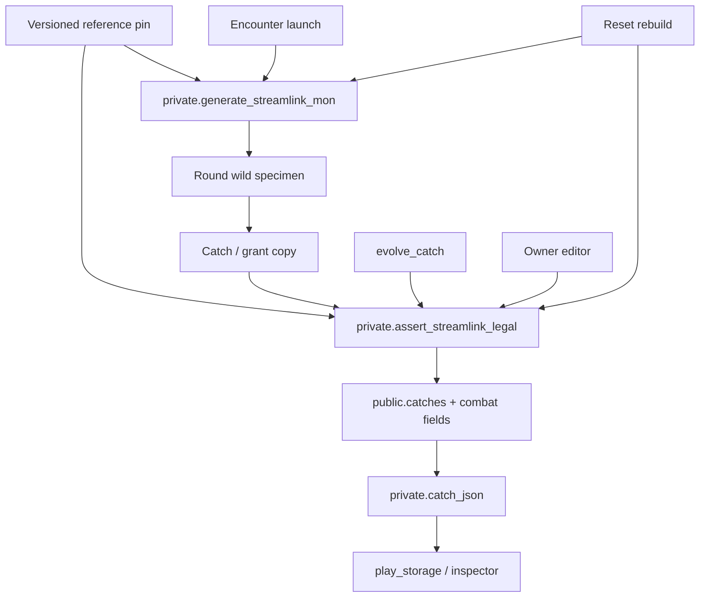

# Gen IX cross-generation Pokémon rebuild (GitHub issue #19)

Parent: epic #18. Authorization: owner **Proceed** after **D17 / A16e**. This issue is **architecture and reset planning only**.

**Locked target:** Modern **cross-generation StreamLink Pokémon** using Generation IX **Scarlet / Violet** (`scarlet-violet`) as the mechanical foundation, plus **versioned, generation-specific reference pins** for species, forms, moves, and abilities that SV does not cover. Legality is **internally valid StreamLink Pokémon**, not SV / HOME / BANK / cartridge export.

Begin with **Kanto**. Keep a clean expansion path to Johto and later regions.

**This batch does not** implement SQL, RPCs, generators, deletes, replacements, merge, or deploy. APP `20261008-rc133`. Smoke paused. Sora / Twinkle not mutated.

| Honesty | Used |
|---|---|
| STATIC | Migrations, player/admin JS, issue #16 audit, D15–D17 |
| LIVE CATALOG | `information_schema` on `dtflmlbjhttoewqgkujf` — tables, columns, FKs. **No** `SELECT` of catch rows |
| REFERENCE | [PokéAPI v2](https://pokeapi.co/docs/v2) `GET /version-group/scarlet-violet/` (id 25, generation-ix). Pokémon HOME SV link and Legends Z-A pages cited by #18 — Z-A real-time combat is **not** the baseline |
| NOT RUN | Encounter, grants, catch-row reads, PRODUCTION observation |

Illustrative specimens in §10 are **fiction**. They are not live Pokémon.

---

## Compact owner spec

| Topic | Decision |
|---|---|
| Mechanics | Gen IX SV: natures, abilities (incl. hidden slot), IVs 0–31, EVs 0–252 / 510 total, SV stat formula, 4 moves + PP |
| Roster v1 | Kanto 1–151 + already-catalogued Kanto-origin forms. Johto later, same engine |
| Learnsets | SV version-group when the species/form exists in SV. Otherwise a **declared fallback pin** — never invent an SV moveset |
| Stream catch odds | Stay StreamLink (`capture_chance`). Separate from individual legality |
| Current LGPE rows | Not converted in place. Future reset under a **separate destructive go/no-go** |
| Inspector / editor | Designed now. Implementation needs A19-INSPECT / A19-EDIT |
| HOME / cartridge | **Not promised** |



---

## 1. Baseline vs replacement

Issue #16 remains the factual snapshot of **current** code. Errata: real LGPE **has natures**; StreamLink does not persist them. D14 describes current state. D15–D17 describe the future.

### 1.1 Current pipeline (cite only)

| Piece | Path | Role today | Rebuild fate |
|---|---|---|---|
| Spawn cap 151 BASE | `private.normal_spawn_max_dex`, `20260918040000_kanto_encounter_containment.sql` | Ordinary AUTO | Keep containment for v1; data-drive later |
| Round launch | `private.launch_community_round` | Shiny 1/4096, gender, level | Keep stream cadence; **attach a generated combat specimen to the round** |
| Catch odds | `private.capture_chance` (`20260913033000_capture_service.sql`) | StreamLink tiers | **Unchanged** — not individual legality |
| Insert | form-aware settle in `20260918050200_form_aware_rpcs.sql` | Identity + ball + form | Insert must pass validator |
| Stamp | `private.stamp_catch_row` (`20260914070000_encounter_pokemon_level.sql`) | md5 IVs, AV 0, last-4 LGPE names, invented size | **Replace** with generator output; do not hash IVs |
| Stats | `private.lgpe_stat` | No nature, AV not EV | **Replace** with Gen IX formula |
| Moves | `private.lgpe_pick_moves` + `lgpe_species` (151) | Names only | **Replace** with pinned learnset + PP |
| JSON | `private.catch_json` | IVs/AVs/moves/GO CP | Emit nature/ability/EVs/PP; CP display-only or drop |
| PC | `play_storage` + `js/storage.js` | Returns combat JSON; UI hides IVs/moves | New fields; UI later (A16f / A19-UX) |
| Evolve | `private.evolve_catch` | Candy/item/trade; keeps IVs/moves | Keep StreamLink evo economy; **revalidate** ability/moves for dest |
| Grant | `admin_grant_pokemon` | 1–151 identity; stamp fills rest | Must call generator + validator |
| Admin mons[] | `admin_account_json` | Newest 40 identity | Inspector RPC is a later read (A19-INSPECT) |

`js/pokedex-reference.js` stays a Pokédex encyclopedia. Runtime **must not** hot-fetch PokéAPI.

### 1.2 Gap matrix (current → Gen IX StreamLink)

| Field | Current | Target |
|---|---|---|
| Nature | absent (and #16 wrongly said LGPE has none) | Required; 25 official natures |
| Ability | Pokédex only | One slot (1 / 2 / hidden) legal for form |
| IVs | persisted, md5 | persisted, 0–31, auditable RNG |
| Training | AVs always 0 | EVs 0–252 / 510; start 0 |
| Stats | `lgpe_stat` | Gen IX with nature |
| Moves | 4 names | 4 slots: move id, PP, origin method, origin version-group |
| Friendship | 0 | Species base (usually 50 or 70) |
| Height/weight | invented `dex%` | Species/form pin, optional size scale |
| CP / Alpha | GO CP + PLA-like Alpha | CP not authoritative; Alpha = StreamLink badge |
| Ruleset / content | absent | `ruleset_id` + `content_build` on every new row |
| HP / status | absent | Persist `hp_current = hp_max`, `status = null` until a battle system exists |
| Held item | absent | Nullable; wild default null |

---

## 2. Reference-data specification

### 2.1 Pin, not live API

| Rule | Detail |
|---|---|
| Runtime | **No** `pokeapi.co` from SQL or browser catch paths |
| Build | Offline extract → versioned JSON/SQL seed with SHA-256 |
| Primary source | [PokéAPI v2](https://pokeapi.co/docs/v2) and [pokeapi data CSVs](https://github.com/PokeAPI/pokeapi/tree/master/data/v2/csv) |
| Pin record | git commit of pokeapi data, extract date, tool version, content_build `sl-ref-YYYYMMDD-<shortsha>` |
| License / provenance | Store URL, commit, and “fan compilation of factual game data — not Nintendo” in `ref_meta` |
| Update | Rebuild pin → review diff → bump `content_build`. Never rewrite stored combat fields because the pin changed |

PokéAPI `GET /api/v2/version-group/scarlet-violet/` returns id **25**, generation-ix, versions scarlet/violet, Pokédexes paldea/kitakami/blueberry. **`move_learn_methods` is an empty array** on that resource. Learn methods must be taken from each `pokemon.moves[].version_group_details`, not from the version-group document. Do not treat an empty VG method list as “SV has no learnsets.”

### 2.2 Canonical IDs

| Entity | ID | Notes |
|---|---|---|
| Species | National dex (`species.dex`, already) | Stable |
| Form | `pokemon_forms.pokemon_form_id` (already) | Keep; add `ref_pokemon_id` (PokéAPI pokemon id) |
| Ability | integer PokéAPI ability id + slug | Slot 1 / 2 / hidden |
| Nature | slug (`adamant`, …) + id 1–25 | 25 natures, no extra |
| Move | integer PokéAPI move id + slug | PP from pin |
| Version-group | slug (`scarlet-violet`, `sword-shield`, …) | Every learnset row names its VG |
| Gender rate | PokéAPI `species.gender_rate` (-1, 0, 1, 2, 4, 6, 8) | Replace hardcoded Kanto array |

### 2.3 Tables (proposed — not created)

```
ref_meta                content_build, pokeapi_commit, built_at, notes
ref_species             dex, slug, gender_rate, base_friendship, hatch, capture_rate, is_legendary, is_mythical
ref_forms               form_id, dex, pokeapi_pokemon_id, types[2], base_hp..spe, height_m, weight_kg, is_base
ref_form_abilities      form_id, slot (1|2|hidden), ability_id, is_hidden
ref_natures             id, slug, up_stat, down_stat  -- null/null = hardy/docile/…
ref_moves               move_id, slug, type, category, pp, power, accuracy
ref_learnsets           form_id, version_group, method, level, move_id
ref_evolutions          from_dex, to_dex, from_form, to_form, method, item, min_level, trade
ref_obtain              form_id, channel (ordinary|special|event|grant), enabled
```

Seed **Kanto 1–151 + existing `pokemon_forms` rows** first. Johto adds rows; it does not fork the engine.

### 2.4 How non-SV species stay StreamLink-valid

1. If the form has **any** `scarlet-violet` learnset rows → those are the legal SV set.
2. If not (Mega, some regional forms, or a later Johto mon not in SV): attach `ref_learnsets` rows from a **declared fallback VG** (recommended v1 fallback: `sword-shield` for national-dex machine/level-up; egg/tutor only if the fallback VG lists them).
3. Stamp each move origin `{method, version_group}` on the individual.
4. Publish an exceptions file: `form_id → fallback_vg → reason`. Never fill empty SV learnsets with invented names.

Abilities and base stats use the **form’s** pin (PokéAPI pokemon resource), which already differs for Alolan / Mega / Hisuian.

### 2.5 Gen IX mechanics that apply to all StreamLink mons

- Stat formula with nature (below)
- IVs 0–31, EVs 0–252 and 510 total
- One ability
- Four moves, PP from pin (PP Ups later, not at generate)
- Friendship
- Gender from `gender_rate`
- Shiny as a variant flag (keep 1/4096 unless an event table says otherwise)

StreamLink **exceptions** (labeled, not “official”): candy evolution, community catch odds, Alpha badge, GO-style CP if kept for display, stream habitats instead of Paldea routes.

---

## 3. Individual model and generator

### 3.1 Stored individual (proposed `public.catches` extensions)

**Generated at spawn / generate() — combat identity**

| Field | Type | Rule |
|---|---|---|
| dex, pokemon_form_id | int | Obtain table + form firewall |
| level | int | Habitat / encounter table, 1–100 |
| nature | text | Uniform 1–25 |
| ability_id, ability_slot | int, text | Slot 1 or 2 equally; hidden only if `p_allow_hidden` |
| iv_hp..iv_spe | int | 0–31 independent |
| ev_hp..ev_spe | int | 0 at generate |
| moves[] | jsonb | 4 objects `{id, name, pp, pp_max, method, version_group}` |
| gender | text | From gender_rate; forced_gender on form wins |
| variant / shiny | text / bool | 1/4096 or event |
| friendship | int | Species base |
| height_m, weight_kg | numeric | Form pin × optional size class |
| ruleset_id | text | `streamlink-gen9-xgen` |
| content_build | text | Pin build |
| encounter_seed | text | Round id or generate nonce |

**Written at catch / grant — provenance**

| Field | Rule |
|---|---|
| user_id, ball, caught_at, round_id, source_key | Existing |
| ot_* , met_level, met_location | Existing OT/met |
| obtained_method | CAPTURE / GRANT / TRADE / EVOLUTION / REBUILD |
| nickname, favorite, locked | Player |
| held_item | null unless grant/event |
| hp_current, status | max / null |
| public_id | Keep `LG########` or new prefix `SL` on **new** rows only |

**Replace** `av_*` with `ev_*` at schema time (reset makes a dual-write period unnecessary).

### 3.2 Stat formula (Gen IX)

```
HP  = floor((2*B + IV + floor(EV/4)) * L / 100) + L + 10
oth = floor((floor((2*B + IV + floor(EV/4)) * L / 100) + 5) * N)
N   = 1.1 raised, 0.9 lowered, else 1.0
```

Shedinja HP stays 1. No nature on HP.

### 3.3 Default move slice

From the form’s **chosen VG** (SV or fallback): all `level-up` moves with `level <= mon.level`, keep the last 4 in learn order. If fewer than 4, keep fewer. **Never** invent Tackle. Record method `level-up` and that VG.

### 3.4 When generation runs

| Event | Combat identity | Provenance |
|---|---|---|
| Community round launch | **Once per round**, stored on `encounter_rounds` | Copied onto each successful catch |
| Admin grant | Fresh generate | GRANT + staff audit |
| Evolution | Keep IVs/EVs/nature/OT; **re-pick ability** if dest lacks the old ability; **do not auto-overwrite moves** unless dest cannot know a move (then replace illegal slots only) | EVOLUTION |
| Rebuild (reset option C) | Fresh generate for that dex/form/level/shiny | REBUILD |
| Trade | No regenerate | TRADE; OT stays |

**Recommended (A19-Q1):** one wild specimen per community round so every catcher of that Pidgey shares IVs/nature/ability/moves. Today each catch hashes its own IVs. Shared specimen is closer to “one wild Pokémon.”

Hidden-ability rate **(A19-Q2):** recommend 0% on ordinary AUTO, event/grant flag only.

### 3.5 StreamLink catch probability

`private.capture_chance` stays product math. A Master Ball may be guaranteed to **catch** and still must store a **legal individual**. Do not encode catch rate into IVs.

---

## 4. Single canonical validator

```
private.assert_streamlink_legal(p_mon jsonb, p_ctx text)
  returns jsonb  -- { ok, errors[] }
```

`p_ctx`: `generate` | `catch` | `grant` | `evolve` | `trade` | `edit` | `rebuild`.

Every write path calls it. Client JS may preview; server is authority.

### 4.1 Invariants

1. dex and form exist in pin; form belongs to dex
2. form is obtainable in `p_ctx` (`ref_obtain`)
3. gender legal for `gender_rate` / `forced_gender`
4. nature is one of 25
5. ability_id ∈ form’s slots; `hidden` only if slot exists **and** context allows
6. each IV ∈ 0–31
7. each EV ∈ 0–252; sum ≤ 510
8. level ∈ 1–100
9. 0–4 moves; each move_id legal for form via **some** pinned learnset row (SV or declared fallback); origin VG recorded
10. pp_max matches pin; 0 < pp ≤ pp_max (once current PP is stored)
11. shiny only via variant rules
12. friendship 0–255
13. `ruleset_id = streamlink-gen9-xgen`
14. `content_build` is a known pin (or `legacy-lgpe` for unmigrated rows — those fail this validator)
15. held item null or in item catalog
16. Shedinja HP = 1; other HP computed
17. Edit context cannot target protected accounts

“Real-game accurate” here means **Gen IX foundation + declared exceptions**. It does **not** mean HOME-legal, event-PID-legal, or SV-transferable.

### 4.2 QA fixtures (deterministic)

| Fixture | Why |
|---|---|
| Bulbasaur lv5 Overgrow, Tackle/Growl/Vine Whip, hardy | Happy path |
| Charizard lv36, Blaze or Solar Power, SV level-up slice | Mid-evo, HA slot exists |
| Nidoran♂ / Nidoran♀ | Gender-locked |
| Magnemite / Voltorb | Genderless |
| Mew / Articuno | Legendary obtain = special/event only |
| Alolan Raichu / Mega Charizard X | Fallback VG; not ordinary AUTO |
| Spinda / Vivillon (later) | Form restrictions |
| Illegal: Tackle on Magikarp-only if not in pin; 32 IV; 253 EV; 511 EV total; Levitate on Bulbasaur; female Gardevoir-line forced male | Reject |
| Evolve: Kadabra → Alakazam keeps IVs; drops illegal move if any | Evolve ctx |
| Johto Mareep stub | Pin row optional; validator fails closed if missing |

Store fixtures as JSON next to `tests/` when implementation starts. No live accounts.

---

## 5. Reset / migration impact

**No catch-row SELECT this batch.** Counts below are templates for a later approved dry-run.

### 5.1 Hard FK to `catches.id` (LIVE CATALOG)

| Table | Column |
|---|---|
| `oak_transfers` | `catch_id` |
| `trade_listings` | `catch_id` |
| `trade_offers` | `catch_id` |

### 5.2 Soft / jsonb references (STATIC + catalog)

| Store | Coupling | Reset effect |
|---|---|---|
| `profiles.team_ids` | uuid[] | Must clear or rewrite |
| `profiles.pc_layout` | jsonb box slots | Stale ids; clear or remap |
| `direct_trades.a_catch / b_catch` | uuid, no FK in catalog | Cancel open trades |
| `evolution_log.catch_id` | uuid, no FK | Orphan log or delete per option |
| `candy_ledger.related_catch` | uuid | Keep ledger; null related or keep orphan |
| `species_seen` / `form_seen` | dex/form, not catch id | Option A keep; B wipe |
| `trainer_stats` | captures, evolved, first_pokemon_dex, shinies | Option A keep counters; B recompute |
| `trainer_achievements` | may encode dex mastery | Option A keep; B review per achievement |
| `family_candy` / inventories / coins / Pass | economy | **Out of scope** unless owner picks B+ |
| `encounter_rounds` / `encounter_players` | historical stream | Keep; they are not live PC |
| Rankings / cosmetics / Oak research | often derived from catches or seen | Recalc after reset; do not wipe coins |
| Helpdesk tickets | may mention a catch id | Keep tickets; do not cascade-delete |

### 5.3 Options

| ID | Scope | Default? | Loss |
|---|---|---|---|
| **R-A** | Live `catches` + team/PC/trade reservations | **Recommended default** | All stored Pokémon. Keep dex seen, candy, coins, Pass, achievements |
| **R-B** | R-A + `species_seen` / `form_seen` + evo/oak catch logs + catch-derived stats/achievements | Optional honesty | Living dex and some trophies reset |
| **R-C** | Regenerate legal replacements: keep dex/form/shiny/nickname/favorite/box if possible | Optional | New IVs/nature/ability/moves; `obtained_method=REBUILD` |

R-C still **deletes combat identity**. It is not a lossless conversion. Do not call rebuilt IVs “the same Pokémon.”

**Never in any option without extra approval:** profiles, Twitch links, coins, Pass, bag items (except evo items if B), helpdesk, staff roles.

**Sora / Twinkle:** excluded from live mutation at this stage. Even a future reset must list them as excluded unless a **separate** protected-account go/no-go says otherwise.

### 5.4 Execution playbook (for a later issue — not now)

1. Encrypted logical backup (`pg_dump` data-only of listed tables) + checksum + off-box copy
2. Manifest: row counts per table, distinct `user_id`, open trades, team sizes — **after** a dedicated data-access approval (still no production DELETE)
3. Dry-run function returns the manifest and `would_delete` counts; `p_commit=false`
4. Referential check: no team/pc slot points at a soon-deleted id
5. Restore drill on a **non-production** clone
6. Encounter freeze (`director` pause) for a short window
7. Player communication
8. Execute only after **A19-RESET-GO**
9. Reconcile: counts, random trainer spot-check, Sora/Twinkle unchanged
10. Rollback = restore dump, not “undelete”

Dry-run template (fill later, not from live SELECT now):

```
reset_id:
option: R-A | R-B | R-C
would_delete.catches_live:
would_cancel.trade_listings_open:
excluded_user_ids: [Sora, Twinkle, …]
backup_sha256:
restore_drill: PASS/FAIL
```

---

## 6. Admin inspector and editor

### 6.1 Read inspector — A19-INSPECT (blocked)

`admin_trainer_pc` / `admin_catch_inspect`:

- `STABLE`, `SECURITY DEFINER`, `is_play_admin` (or owner-only if chosen)
- Paginated full PC, not newest 40
- Payload = validator-safe `catch_json` + provenance (`source_key`, `ruleset_id`, `content_build`, `encounter_seed`)
- Battle/stat view: computed stats, IVs, EVs, nature, ability, moves/PP
- Sora/Twinkle **readable**, not editable
- Not `admin_overview`

Hub chrome waits on A9. Until then, a staff-only debug page or RPC via existing tools is enough if A19-INSPECT is approved.

### 6.2 Owner editor — A19-EDIT (blocked, after inspector)

Same contract as #16 §8.2, now against Gen IX invariants:

- Owner role only; R18 moderators do **not** inherit
- Protected accounts hard-block
- Whitelist fields; no raw SQL
- `p_commit` dry-run + before/after diff
- `p_reason`, `p_case_id` (helpdesk #14 later)
- Append-only `catch_audit`
- Rollback via validator, not unrestricted UPDATE
- Idempotency key

Threat model: stolen owner session, confused-deputy grant RPC, moderator using R18, staff editing Sora to “test,” client-forged IVs on `play_storage` save. Mitigations: owner check inside the write RPC, no player write of combat fields, audit table, dry-run default, protected-account denylist.

---

## 7. Phased implementation (each issue separately approvable)

All **WRITE** phases are **BLOCKED** until the named approval.

| Phase | Proposed issue | Approval | Writes? | Acceptance |
|---|---|---|---|---|
| 0 | **#19 this doc** | Proceed (done) | No | Owner review |
| 1 | Reference pin + build tool + checksum tests | **A19-REF** | Seed tables only | Kanto fixtures parse; no pokeapi at runtime; empty SV learnset ⇒ fallback or fail, never invent |
| 2 | Schema: ev/nature/ability/moves jsonb/ruleset | **A19-SCHEMA** | DDL | Catalog tests; no live UPDATE of combat yet |
| 3 | `generate_streamlink_mon` + `assert_streamlink_legal` + fixtures | **A19-GENVAL** | Functions, no player rows | Fixture matrix green on local/clone |
| 4 | Wire launch / settle / grant / evolve / trade | **A19-WIRE** | New catches only | New PlayTester catch validates; Sora/Twinkle unused |
| 5 | Read inspector RPC | **A19-INSPECT** | No combat writes | Staff can page a QA PC |
| 6 | Owner editor | **A19-EDIT** | Owner edits | Dry-run + audit on QA only |
| 7 | Reset dry-run + backup restore on clone | **A19-RESET-TEST** | Clone only | Restore drill PASS |
| 8 | Production reset | **A19-RESET-GO** | **Destructive** | Manifest signed; Sora/Twinkle excluded |
| 9 | Deploy / APP stamp | A4 + smoke | Release | Explicit; smoke still paused until then |

Do not combine 8 with 4. New generator can ship to **new** catches while old rows remain `legacy-lgpe` and fail the new validator until reset.

A3 / A9 / Batch F / #13 / #14 / #15 / #17 stay separate. R1 / R2 / R18 stay OPEN. R21 stays CLOSED.

---

## 8. Security / threat model (owner functions)

| Threat | Mitigation |
|---|---|
| Anonymous EXECUTE (R2) | New RPCs: `authenticated` only; `REVOKE` from `anon`; server role check |
| Broad moderator (R18) | Editor = owner only. Inspector may be staff-read |
| `admin_overview` (R1) | Do not reuse it |
| Grant as stealth editor | Grant calls generate; cannot set IVs by parameter |
| Reset as support tool | Reset RPCs do not exist until A19-RESET-GO; then owner + confirm phrase |
| Backup leakage | Encrypted dump; no commit of dumps |
| Client authority | Players cannot POST combat fields |

---

## 9. Unresolved owner questions (only these)

| ID | Question | Recommendation |
|---|---|---|
| **A19-Q1** | Shared wild specimen per community round, or per-catcher rolls? | Shared per round |
| **A19-Q2** | Ordinary hidden-ability rate? | 0% ordinary; event/grant only |
| **A19-Q3** | Reset option when the time comes? | R-A (catches + team/PC/trades). Keep dex/economy |
| **A19-Q4** | Fallback VG for non-SV forms? | `sword-shield` national learnsets, listed in exceptions file |
| **A19-Q5** | Persist current HP/status before any battle system? | Yes: current = max, status null |
| **A19-Q6** | Include Sora/Twinkle in a future reset? | **No** unless a later protected-account go/no-go |

Implementation approvals A19-REF … A19-RESET-GO are **not** granted by this document.

---

## 10. Illustrative specimens (NOT live data)

Do not treat these as production rows.

### 10.1 Bulbasaur — ordinary Kanto catch

```
dex: 1
formId: 1 (base)
level: 5
nature: hardy            # 1.0 all
ability: overgrow        # slot 1
abilitySlot: 1
gender: Male
shiny: false
ivs: {hp: 12, atk: 8, def: 19, spa: 21, spd: 14, spe: 7}
evs: {hp: 0, atk: 0, def: 0, spa: 0, spd: 0, spe: 0}
moves:
  - {id: 33, name: Tackle,    pp: 35, method: level-up, version_group: scarlet-violet}
  - {id: 45, name: Growl,     pp: 40, method: level-up, version_group: scarlet-violet}
  - {id: 22, name: Vine Whip, pp: 25, method: level-up, version_group: scarlet-violet}
friendship: 50
heldItem: null
ruleset_id: streamlink-gen9-xgen
obtained_method: CAPTURE
# computed HP/Atk/… via §3.2 — display only in this fiction
```

If PokéAPI SV rows for Bulbasaur level-up differ from this slice, the **pin** wins. This block is pedagogy.

### 10.2 Charizard — evolved, HA legal but not rolled

```
dex: 6
formId: 6 (base, not Mega)
level: 36
nature: modest           # spa 1.1, atk 0.9
ability: blaze           # slot 1; solar-power is hidden and was not granted
gender: Female
shiny: false
ivs: {hp: 31, atk: 4, def: 20, spa: 28, spd: 22, spe: 15}
evs: all 0
moves: last 4 SV level-up at 36 (pin decides names)
obtained_method: EVOLUTION
# Mega X would be a different form_id, fallback VG, not ordinary AUTO
```

---

## 11. Test matrix (planning)

| Area | When | Class if green |
|---|---|---|
| This plan exists, D17, no `admin_catch_inspect` in `admin-next` | Now | STATIC |
| Pin checksum + Kanto fixture parse | A19-REF | LOCAL HARNESS |
| Validator fixtures §4.2 | A19-GENVAL | LOCAL HARNESS |
| Shared-round specimen copy | A19-WIRE | LOCAL / clone REAL RPC |
| Grant cannot pass raw IVs | A19-WIRE | LOCAL |
| Inspector pages QA PC | A19-INSPECT | REAL RPC on QA |
| Editor dry-run + protected reject | A19-EDIT | REAL RPC on QA |
| Reset restore drill | A19-RESET-TEST | Clone only |
| Production reset | A19-RESET-GO | PRODUCTION — not now |

Honesty labels stay STATIC · LOCAL HARNESS · REAL DOM · REAL RPC · PRODUCTION.

---

## 12. What this batch did not do

No SQL/RPC, no generator code, no DELETE/TRUNCATE, no replacement rows, no production catch SELECT, no encounter, no grants, no role changes, no `admin-next.html` / `admin.html` / `js/admin-live.js`, no merge/deploy/APP stamp, no Batch F.

**Stop.** Next work needs an explicit implementation approval (start with **A19-REF** or answers to A19-Q1–Q6). Destructive reset needs **A19-RESET-GO** after A19-RESET-TEST.
